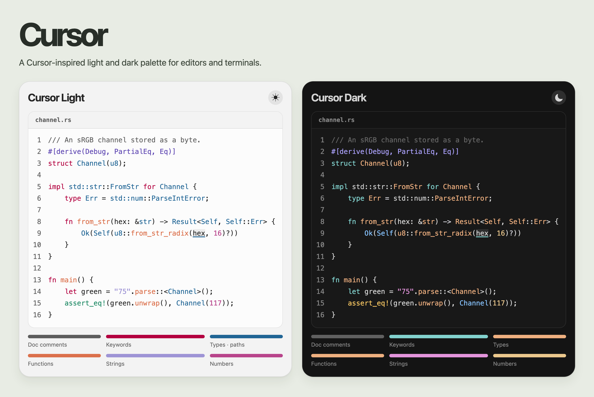

# Cursor Theme

A community theme inspired by Cursor’s light and dark palettes. Available in **Cursor Light** and **Cursor Dark**.



## Install

### Zed

Clone this repository, run **zed: install dev extension**, and select the cloned directory.
Select **Cursor Light** or **Cursor Dark** from Zed’s theme selector. To follow the system appearance and apply the recommended settings, use:

```json
{
  "theme": {
    "mode": "system",
    "light": "Cursor Light",
    "dark": "Cursor Dark"
  }
}
```

### VS Code

Download the `.vsix` from [GitHub Releases](https://github.com/eugenebokhan/cursor-theme/releases). Run **Extensions: Install from VSIX…**, then choose **Cursor Light** or **Cursor Dark** with **Preferences: Color Theme**.

### Helix

Copy the [Helix themes](ports/helix/) to `~/.config/helix/themes/` or `%AppData%\helix\themes\` on Windows. Run `:theme cursor-light` or `:theme cursor-dark`. To persist your choice, set `theme = "cursor-dark"` at the top of `config.toml`.

### Xcode

Copy the [Xcode themes](ports/xcode/) to `~/Library/Developer/Xcode/UserData/FontAndColorThemes/`. Create the folder if needed. In Xcode, open **Settings → Themes** and choose **Cursor Light** or **Cursor Dark**.

### Codex CLI

Copy the [TextMate themes](ports/codex/) to `$CODEX_HOME/themes/` (`~/.codex/themes/` by default). Restart Codex if needed, run `/theme`, and select the theme variant that matches your terminal background. This sets syntax highlighting in Codex. Use a terminal profile below for the window background and ANSI colors.

### Ghostty

Copy the [Ghostty themes](ports/ghostty/) to `~/.config/ghostty/themes/`. Add `theme = light:Cursor Light,dark:Cursor Dark` to your Ghostty config.

### Rio

Copy the [Rio themes](ports/rio/) to `~/.config/rio/themes/`. Add `theme = "cursor-dark"` at the top of `config.toml`, or use the adaptive theme setting:

```toml
[adaptive-theme]
light = "cursor-light"
dark = "cursor-dark"
```

## Build

Edit [the source theme](themes/cursor.json), run `bun run build`, and commit the generated ports. `bun run check` verifies the generated files. Both commands use the pinned [Proof exporter](https://github.com/eugenebokhan/proof-theme/tree/theme-tools-v1/scripts). To rebuild the preview, run `bun run preview /path/to/chromium`.

[MIT License](LICENSE)
